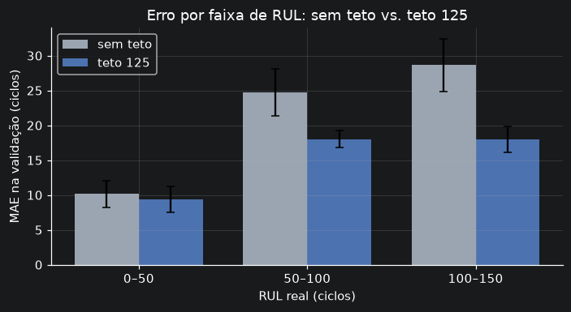
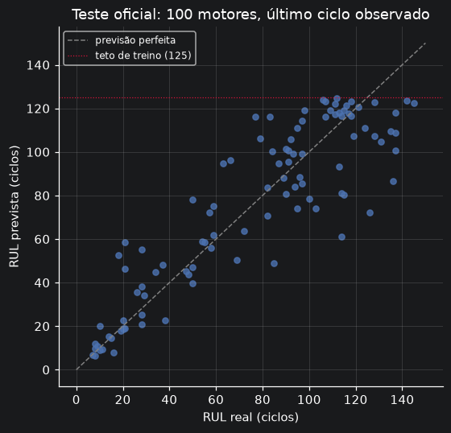
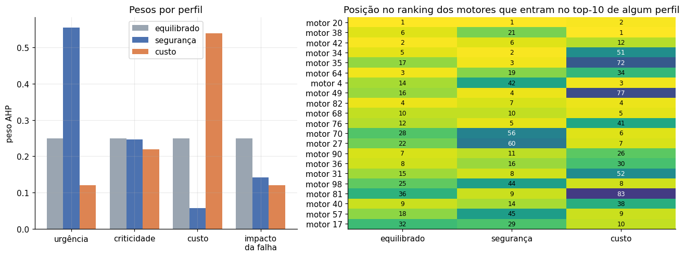
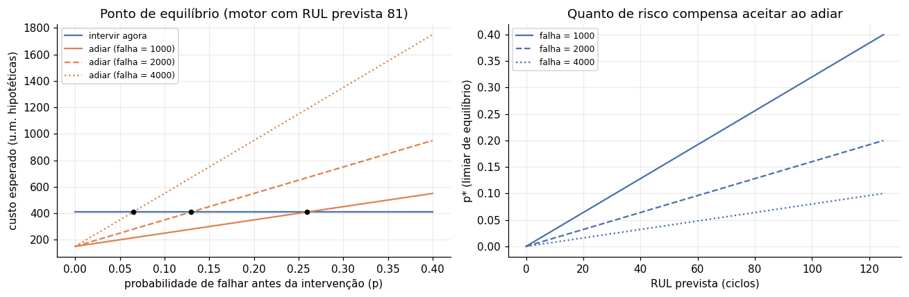

# Manutenção preditiva de turbofans e priorização multicritério

Estimativa de vida útil restante (RUL) com Machine Learning e priorização de intervenções com **AHP + TOPSIS**, usando os dados simulados NASA C-MAPSS (subconjunto FD001).

> **Aviso.** Os dados são simulados e os critérios de criticidade, custo e impacto da parada, bem como todos os valores monetários, são **hipotéticos**. O projeto demonstra método e raciocínio de decisão; não descreve nenhuma planta real nem fornece recomendações operacionais.

## Resumo dos resultados

- **Modelo de RUL:** no teste oficial (100 motores, último ciclo observado), MAE de **13.8** e RMSE de **18.7** ciclos, contra 39.1 e 49.8 do baseline. O modelo vence o baseline nas 5 partições da validação cruzada por motor.
- **Decisão técnica principal:** limitar a RUL de treino a 125 ciclos reduziu o RMSE na região de interesse (RUL real ≤ 150) de 28.2 para 19.7 ciclos na validação, e praticamente eliminou o viés (de +10,4 para −0,3 ciclos).
- **Priorização:** três perfis de decisor (equilibrado, segurança, custo) com julgamentos AHP consistentes geram rankings diferentes; 3 motores (20, 68, 82) ficam no top-10 dos três perfis.
- **Custos:** análise ilustrativa de "intervir agora ou adiar" com limiar de equilíbrio `p*`.

## Problema

Uma equipe de manutenção tem recursos limitados e precisa decidir qual equipamento atender primeiro. O fluxo aqui vai de dados de sensores a um ranking de prioridade:

1. estimar a RUL de cada motor a partir dos sensores;
2. transformar a RUL prevista em um critério de urgência;
3. combinar urgência com critérios de negócio (hipotéticos) por AHP e TOPSIS;
4. discutir, de forma ilustrativa, quando adiar uma intervenção compensa.

## Dados

NASA C-MAPSS, subconjunto FD001 (uma condição operacional, um modo de falha): 100 motores de treino (trajetória até a falha) e 100 de teste (trajetória truncada), com a RUL real do teste em arquivo separado. Fonte: NASA Prognostics Center of Excellence (repositório de dados de prognóstico, "Turbofan Engine Degradation Simulation"). Confira a licença e as condições de uso na fonte.

Os arquivos **não** estão neste repositório: baixe `train_FD001.txt`, `test_FD001.txt` e `RUL_FD001.txt` e coloque em `data/raw/`.

## Como executar

Requer Python 3.10 ou superior.

```bash
python -m venv .venv
source .venv/bin/activate          # Windows: .venv\Scripts\activate
pip install -r requirements.txt
# coloque os 3 arquivos FD001 em data/raw/

pytest -q                          # testes automatizados
python -m src.modeling             # validação cruzada + teste oficial -> reports/
streamlit run app.py               # dashboard

pip install jupyterlab             # opcional, para os notebooks
jupyter lab notebooks/
```

Os resultados em `reports/` já estão versionados, então o dashboard abre logo após clonar. Para regenerá-los, use os comandos acima. Os resultados são determinísticos (`random_state=42`); versões diferentes de bibliotecas podem alterar casas decimais. Resultados deste README obtidos com Python 3.12.3, scikit-learn 1.8.0, pandas 3.0.2 e numpy 2.4.4.

## Estrutura

```
src/
  data_processing.py   leitura, auditoria e RUL de treino
  features.py          atributos por janela retrospectiva (só passado) e remoção de constantes
  metrics.py           MAE, RMSE, escore assimétrico do C-MAPSS e erro por faixa de RUL
  modeling.py          validação cruzada por motor, modelo final e avaliação no teste
  ahp.py               pesos AHP por autovetor e razão de consistência
  topsis.py            ordenação TOPSIS (critérios de custo e de benefício)
  decision.py          critérios, perfis de decisor e ranking
  economics.py         cenário ilustrativo: intervir agora vs. adiar
notebooks/             01 dados e modelo | 02 priorização e custos
reports/               métricas, previsões, rankings e figuras
tests/                 testes automatizados (pytest)
app.py                 dashboard Streamlit
```

## Método

**Validação.** `GroupKFold` com 5 partições, separando por motor (os ciclos de um motor nunca ficam em treino e validação ao mesmo tempo). O teste oficial é avaliado uma única vez, depois de escolher a variante. As métricas sempre comparam com a RUL **real** (sem teto).

**Atributos.** Para cada ciclo, valor atual, média, desvio e tendência dos sensores e configurações em uma janela retrospectiva de 5 ciclos, mais o número do ciclo; só usa o passado. Colunas constantes no treino são removidas.

**Modelo.** `HistGradientBoostingRegressor` com hiperparâmetros fixos (sem busca), comparado a um baseline constante (mediana do alvo de treino).

**Priorização.** Quatro critérios:

| Critério | Origem | Direção |
|---|---|---|
| Urgência: `1 − RUL prevista / 125`, em [0, 1] | modelo | benefício |
| Criticidade operacional (1–3) | hipotético | benefício |
| Índice de custo de intervenção (1–10) | hipotético | custo |
| Impacto da parada (1–10) | hipotético | benefício |

Pesos por AHP (autovetor principal, razão de consistência), ordenação por TOPSIS (normalização vetorial, solução ideal e anti-ideal diferentes para benefício e custo). Os critérios hipotéticos são sorteados com semente fixa e de forma independente. A RUL prevista é uma estimativa pontual e é usada diretamente como indicador de urgência, não como "probabilidade de falha".

## Resultados

### 1. Teto da RUL: sem teto vs. teto de 125 (validação cruzada)

| Variante | RMSE (RUL real ≤ 150) | Viés (RUL real ≤ 150) | MAE faixa 50–100 | MAE faixa 100–150 | MAE em todas as linhas |
|---|---|---|---|---|---|
| Sem teto | 28.2 ± 2.0 | 10.4 ± 3.4 | 24.0 ± 1.7 | 27.9 ± 2.2 | 26.7 ± 1.3 |
| Teto 125 | 19.7 ± 1.1 | -0.3 ± 2.4 | 17.5 ± 1.8 | 17.6 ± 1.5 | 31.8 ± 1.3 |

O baseline tem RMSE de 51.9 na mesma região. O MAE sobre todas as linhas piora com o teto porque inclui motores com RUL real acima de 150, que não aparecem no teste oficial; por isso o critério de decisão foi o erro na região de interesse e por faixa.



### 2. Teste oficial (uma única avaliação)

| | MAE (ciclos) | RMSE (ciclos) | Escore C-MAPSS |
|---|---|---|---|
| Baseline (mediana do alvo) | 39.1 | 49.8 | 166571 |
| Modelo (teto 125) | 14.0 | 19.1 | 667 |

Viés médio: -0.7 ciclos; 52% dos motores foram superestimados.

| RUL real (ciclos) | Motores | MAE | Viés |
|---|---|---|---|
| 7–30 | 25 | 8.2 | +5.9 |
| 31–60 | 14 | 9.1 | +3.3 |
| 61–100 | 28 | 15.7 | +5.5 |
| 101–145 | 33 | 19.0 | -12.7 |

O erro cresce nas faixas de RUL mais altas, onde os sensores mostram pouca degradação. Com o teto, o modelo tende a subestimar motores muito saudáveis (erro conservador, mas que gera intervenções antecipadas).



### 3. Priorização multicritério

| Perfil | Urgência | Criticidade | Custo | Parada | CR |
|---|---|---|---|---|---|
| Equilibrado | 0.25 | 0.25 | 0.25 | 0.25 | 0.000 |
| Segurança | 0.56 | 0.25 | 0.06 | 0.14 | 0.025 |
| Custo | 0.12 | 0.22 | 0.54 | 0.12 | 0.008 |

Todas as razões de consistência (CR) ficam abaixo de 0,10. Correlação de postos (Spearman) entre perfis: equilibrado × segurança = 0.75, equilibrado × custo = 0.48, segurança × custo = -0.02. Os motores 20, 68, 82 estão no top-10 dos três perfis (RUL prevista de 9 a 12 ciclos); as posições intermediárias dependem do perfil.

Sensibilidade: trocar a urgência linear por `1 / (1 + RUL)` mantém os mesmos 3 motores de topo comuns aos perfis, mas altera as posições intermediárias (motores em comum no top-10 entre as duas versões: Equilibrado 5, Segurança 8, Custo 8).



### 4. Cenário econômico ilustrativo

Intervir agora custa a intervenção, a parada planejada e a vida útil desperdiçada; adiar custa a intervenção e a parada, mais a chance `p` de falha não planejada. O ponto de equilíbrio é `p* = vida desperdiçada / custo da falha`. Com valores hipotéticos (componente = 400 u.m., falha = 2000 u.m.), `p*` é 1.4% para o motor mais prioritário (RUL prevista 9) e 12.8% para um motor de RUL mediana (80). Quanto maior a RUL e mais barata a falha, mais risco compensa aceitar ao adiar.



## Limitações

- Dados simulados de um único subconjunto (FD001) e apenas 100 motores de teste: os resultados não se generalizam sem validação adicional.
- O escore assimétrico do C-MAPSS depende de poucos erros grandes; o escore de validação cruzada não é reportado porque somaria milhares de linhas.
- A validação cruzada avalia todos os ciclos, enquanto o teste avalia só o último ciclo de motores truncados; um pseudo-teste com cortes aleatórios seria mais fiel.
- Hiperparâmetros fixos e teto de 125 ciclos por convenção (não otimizado); nenhuma incerteza foi estimada.
- Critérios de decisão, perfis de decisor e custos são hipóteses; em uso real, viriam de especialistas e da operação. O modelo de custo é simplificado (um único adiamento, sem desconto no tempo).
- Ao revisar o modelo inicial, os erros do teste oficial foram inspecionados de forma diagnóstica, o que levantou a hipótese do teto; a decisão foi tomada na validação cruzada e nenhum hiperparâmetro foi ajustado com o teste.

## Próximos passos possíveis

- Restrições de monotonicidade justificadas fisicamente e pós-processamento temporal das previsões.
- Pseudo-teste com cortes aleatórios na validação.
- Estimativa de incerteza (por exemplo, regressão quantílica) e uso da probabilidade no cenário econômico.
- Outros subconjuntos do C-MAPSS (FD002 a FD004), com várias condições operacionais.
